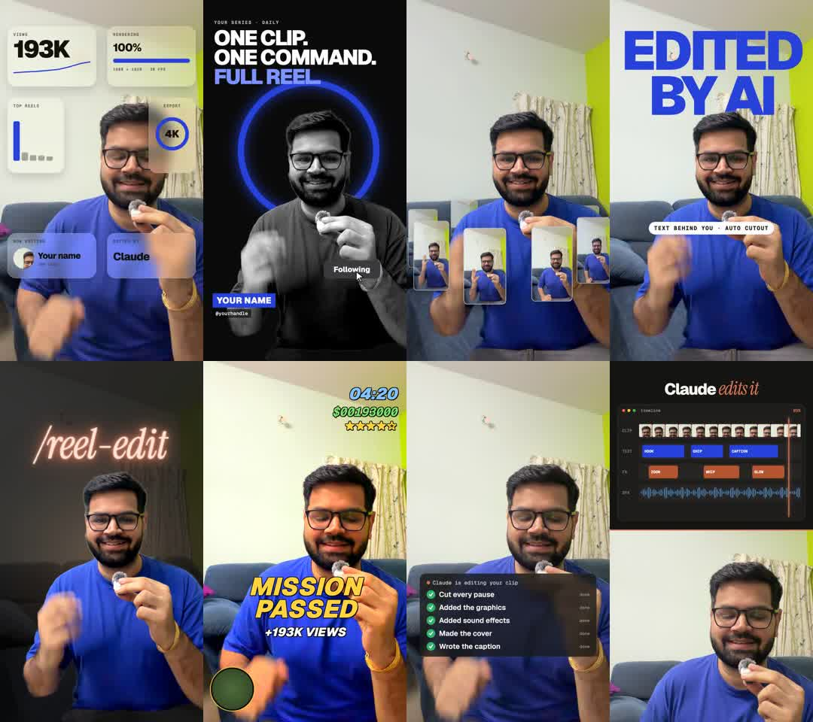

# reel-edit-starter

8 animated looks for vertical reels. You record one clip, pick a look, and render a 1080x1920 mp4.
Every look is a plain HTML file, so you can change any word, colour or position by asking Claude Code.



| Look | What it does | Needs cut-out |
|---|---|---|
| `glass` | Frosted glass widgets pop in around you | |
| `documentary` | Black and white, glowing ring behind your head, name bar, Follow click | yes |
| `orbit` | Cards circle around you, behind and in front | yes |
| `behind` | Huge text sits behind your head | yes |
| `spotlight` | Room goes dark, neon sign flickers on behind you | yes |
| `gaming` | Game HUD and a "Mission passed" stamp | |
| `checklist` | A glass panel ticks off each step | |
| `timeline` | Editing timeline on top, you below | |

## Setup (once, about 10 minutes)

You need a Mac (Linux works too) and [Claude Code](https://claude.com/claude-code).

```bash
git clone https://github.com/shubh10395/reel-edit-starter.git
cd reel-edit-starter
./setup.sh            # ffmpeg, Node.js, Puppeteer
./setup.sh --cutout   # optional: PyTorch, for the 4 looks that cut you out
```

## Make your first look

```bash
./extract.sh my-clip.mov 0 3            # 3 seconds from the start of your clip
node render.js looks/glass.html         # -> out/glass.mp4
```

For a cut-out look, add `--cutout`:

```bash
./extract.sh my-clip.mov 4.5 2.6 --cutout
node render.js looks/behind.html        # -> out/behind.mp4
```

Open any file in `looks/` in Chrome to watch a live preview while you edit it.
Each look has a `CONFIG` block at the top with its words and colours.

## Join looks into one reel

`extract.sh` replaces the last clip each time, so extract and render one look at a time, then join them:

```bash
./stitch.sh out/reel.mp4 out/glass.mp4 out/behind.mp4 out/gaming.mp4
```

## Edit with Claude Code

Open Claude Code in this folder and talk to it. It reads `CLAUDE.md` and knows how the repo works.
Ready-made messages are in [PROMPTS.md](PROMPTS.md). For example:

> Use my clip clip.mov. Take the best 3 seconds where I point up, cut me out, and render the behind look with the words "Built in / 1 day".

## How it works

1. `extract.sh` crops your clip to 1080x1920 at 30 fps and saves every frame to `work/`.
2. With `--cutout`, `tools/matte.py` runs [Robust Video Matting](https://github.com/PeterL1n/RobustVideoMatting) on your computer to cut you out. The model downloads on first use and is GPL-3.0 licensed.
3. Each look draws one frame for any time `t`. `render.js` opens it in headless Chrome, steps through every frame, and pipes the screenshots into ffmpeg.

If ffmpeg is installed somewhere unusual, set `FFMPEG=/path/to/ffmpeg`.

## Credits

Made by Shubham, [@buildai.with.shubh](https://www.instagram.com/buildai.with.shubh/) on Instagram. MIT licensed: use it for your own reels, change anything.
